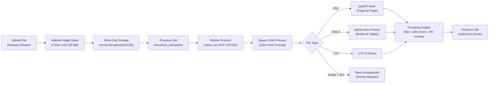
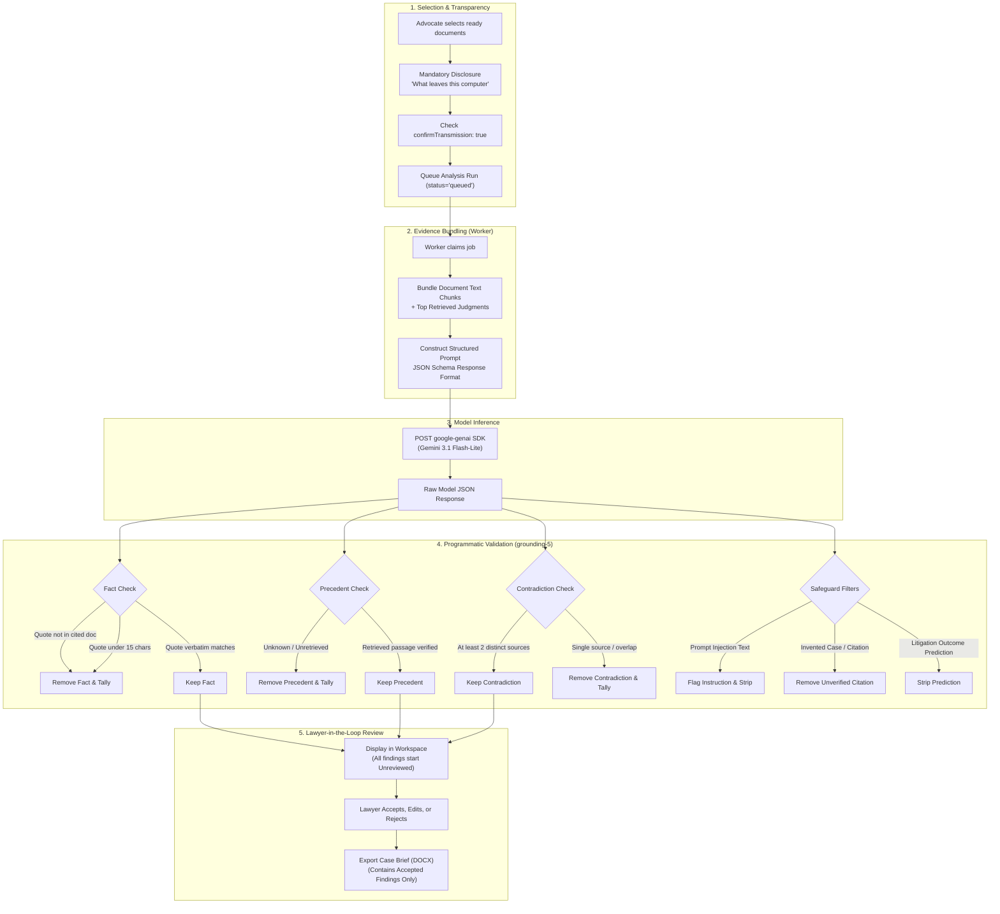

# LexFlow — Legal Case Management System & Research Assistant

## 1. Project Title, Badges and Description

[](https://github.com/Aryan-Goyal30/LexFlow/actions/workflows/ci.yml)
[](https://fastapi.tiangolo.com)
[](https://react.dev)
[](https://www.typescriptlang.org)
[](https://www.postgresql.org)
[](https://www.python.org)

**LexFlow** is a web-based Legal Case Management System and Research Assistant designed for law firm litigation workflows. Developed as a major Software Engineering project, it models the end-to-end lifecycle of active disputes in an Indian legal context (Supreme Court of India, High Courts, District & Sessions Courts; "Advocate" terminology).

In litigation practice, case papers, procedural hearing deadlines, client communications, and precedent research are routinely fragmented across physical files, email threads, and disconnected tools. Generic generative AI tools introduce severe professional and ethical risks: fabricated case citations, ungrounded factual assertions, leakage of confidential client data, and an absence of verifiable provenance.

LexFlow addresses these challenges through dedicated matter workspaces, server-side role-based access control, local document processing, a precedent library with source terms tracking, and an **evidence-grounded AI analysis pipeline**. Every AI assertion must be programmatically verified against uploaded case papers or stored judicial decisions before presentation to an advocate. Findings remain subject to mandatory lawyer review and acceptance before inclusion in generated court briefs.

---

## Table of Contents

1. [Project Title, Badges and Description](#1-project-title-badges-and-description)
2. [Project Overview and Implementation Status](#2-project-overview-and-implementation-status)
3. [Key Features and User Roles](#3-key-features-and-user-roles)
4. [System Architecture](#4-system-architecture)
5. [Technology Stack](#5-technology-stack)
6. [End-to-End Application Workflow](#6-end-to-end-application-workflow)
7. [Authentication, Authorization and Security](#7-authentication-authorization-and-security)
8. [Document Upload, Storage and Extraction](#8-document-upload-storage-and-extraction)
9. [Legal Research and Judgment Corpus](#9-legal-research-and-judgment-corpus)
10. [AI Case Analysis and Evidence Validation](#10-ai-case-analysis-and-evidence-validation)
11. [Phase 7 Outcome Assessment](#11-phase-7-outcome-assessment)
12. [Installation and Setup (Windows)](#12-installation-and-setup-windows)
13. [Testing and Quality Assurance](#13-testing-and-quality-assurance)
14. [API Specification](#14-api-specification)
15. [Repository Structure](#15-repository-structure)
16. [Limitations and Responsible Use](#16-limitations-and-responsible-use)
17. [Roadmap and Future Work](#17-roadmap-and-future-work)
18. [Project Documentation and Traceability](#18-project-documentation-and-traceability)

---

## 2. Project Overview and Implementation Status

### Operational Surfaces
LexFlow structures law firm operations across five distinct surfaces:

1. **Staff Case Workspace (`/app/cases/:caseId`):** The operational workspace for legal teams, partitioned into four persistent tabs:
   - **Overview:** Case metadata, server-allocated case numbers (`LF-<year>-<sequence>`), matter status, assigned advocates and paralegals, scheduled hearings, and an immutable timeline.
   - **Documents:** Matter file management, upload tracking, asynchronous text extraction status, page-by-page text viewing, re-extraction triggers, client sharing controls, and soft-delete/restore queues.
   - **AI Analysis:** Document selection, transmission disclosure ("What leaves this computer"), background execution tracking, verified findings display (facts, issues, precedents, contradictions, flagged prompt-injection text), lawyer review actions, and DOCX brief export.
   - **Research:** Case-scoped precedent retrieval across the firm's judgment collection using keyword full-text matching or semantic/hybrid search.
2. **Administrator Console (`/app/admin/*`):** Restricted to users with the `Administrator` role. Provides user provisioning (no self-registration), credential resets, temporary password issuance, failed-login lockout release, account deactivation, and inspection of the database-level append-only audit log.
3. **Client Portal (`/portal`):** A strictly isolated interface for firm clients. Clients view only their own active, non-archived legal matters, scheduled hearings, and documents that an advocate has explicitly shared. Client accounts cannot access staff records, internal notes, team assignments, or AI analyses.
4. **Firm-Wide Management Views:** Global views across all permitted matters:
   - **Practice Overview (`/app/dashboard`):** Aggregated matter metrics, recent activity, and upcoming hearing schedules.
   - **Hearings Schedule (`/app/hearings`):** Chronological hearing calendar with 7-day, 30-day, past, and cancelled filters.
   - **Client Directory (`/app/clients`):** Client contact directory and linked matter portfolios.
   - **Precedent Library (`/app/precedents`):** Firm-wide judgment search, filtering by court, year, and corpus origin (genuine vs. synthetic), with full source attribution and terms-of-use records.
   - **Global Search:** Real-time top-bar search dropdown across case numbers, titles, courts, parties, clients, and document filenames (`GET /api/search`).
5. **Background Document & Analysis Worker:** A standalone Python process (`python -m lexflow.worker`) executing resource-intensive operations outside the web request cycle: text extraction from PDFs and Word documents, local ONNX vector embedding generation, and queued AI analysis orchestration.

### Implementation Status

> **Audit Date: 2026-10-31**
> - **Phases 1–6 (Core Application):** Implemented and verified locally across backend, frontend, and end-to-end automated test suites. Covers accounts, sessions, roles, case workspaces, teams, hearings, document storage, background text extraction, precedent research, AI analysis with evidence verification, lawyer review, and DOCX brief export.
> - **Phase 7 (Outcome Assessment):** Implemented exclusively as an **experimental synthetic-data engineering demonstration** for decision support, disabled by default. General production deployment and real-world legal predictive use are blocked pending external prerequisites (see [Phase 7 Outcome Assessment](#11-phase-7-outcome-assessment) and [Limitations and Responsible Use](#16-limitations-and-responsible-use)).
> - **Deployment Envelope:** Local development and evaluation only (`127.0.0.1`). The backend binds strictly to loopback addresses and has not undergone production network hardening.

---

## 3. Key Features and User Roles

### User Roles & Responsibilities

Access control is governed by four user roles, evaluated on the server against explicit case relationships (`server/lexflow/authz.py`):

| Role | Operational Scope & Permissions |
|---|---|
| **Administrator** | Full system administration. Provisions accounts, resets passwords, unlocks locked accounts, deactivates users, inspects audit logs, archives/unarchives cases, and reassigns lead advocates or clients. Has view and management access across all matters. |
| **Advocate** | Manages assigned legal matters. When designated as Lead Advocate, creates cases, manages case team members, and soft-deletes/restores documents. Edits case details, manages hearings, uploads documents, toggles client sharing, initiates AI analysis runs, reviews AI findings, and generates DOCX briefs. |
| **Paralegal** | Operational support on assigned matters. Updates court and opposing party information (`EDIT_LISTING`), manages hearing schedules, uploads documents, and views extracted text. Can view AI analysis results and review decisions, but cannot trigger analysis runs, record review decisions, or view private reviewer notes. |
| **Client** | Client Portal access only. Strictly isolated read-only access to their own active cases, scheduled hearings, and explicitly shared documents. Cannot view staff workspaces, internal notes, timelines, team assignments, unshared files, research tabs, or AI analyses. |

### Feature Groups

#### User & Administration
- **Strict Administrator Provisioning:** No public self-registration. All accounts are created by an Administrator via the console or CLI (`python -m lexflow.cli.users create`).
- **Temporary Password Enforcement:** Newly created or reset accounts receive temporary credentials expiring in 72 hours, requiring a permanent password change upon initial login.
- **Brute-Force Lockout:** Five consecutive incorrect password attempts lock the account for 15 minutes. Lockouts can be cleared immediately by an Administrator.
- **Session Lifecycle:** 256-bit cryptographic session tokens stored in `HttpOnly`, `SameSite=Strict` cookies. Automatic termination after 30 minutes of inactivity or 12 hours absolute duration.
- **Append-Only Audit Log:** Database audit log (`audit_events`) protected by a PostgreSQL row-level trigger preventing `UPDATE` and `DELETE` operations. Records authentication events, permission denials, case mutations, and document text access.

#### Legal Case Management
- **Deterministic Case Numbering:** Server-generated sequence numbers in the format `LF-<YYYY>-<####>` driven by transactional sequence counters (`case_number_counters`).
- **Granular Permissions Matrix:** Case-level authorization evaluating user relationships (`Admin`, `Lead`, `Associate`, `Paralegal`, `Client`, `None`) on every request.
- **Dynamic Case Teams:** Lead advocates and administrators can assign or remove associate advocates and paralegals, immediately updating matter access.
- **Hearing Lifecycle:** Scheduling, date amendments, and cancellations with mandatory reason tracking. Cancelled hearings remain on record for compliance but are excluded from active countdowns.
- **Matter Archiving:** Administrators can archive completed cases. Archived matters become completely read-only across all endpoints and are excluded from default listings until restored.
- **Reversible Soft Deletion:** Documents and cases are never purged through regular UI actions. Documents are marked with `deleted_at` and can be restored byte-for-byte by the lead advocate or administrator from a dedicated view.

#### Document Management & Intelligence
- **Multi-Format Ingestion:** Accepts PDF (`.pdf`), Word (`.docx`, `.doc`), Plain Text (`.txt`), and Images (`.png`, `.jpg`, `.jpeg`, `.gif`, `.webp`) up to 25 MB (`LEXFLOW_MAX_UPLOAD_BYTES`).
- **MIME & Content Validation:** Streaming content inspection verifying that binary magic bytes match the file extension, preventing extension spoofing.
- **Decoupled Local Storage:** Files are written to local disk (`LEXFLOW_UPLOAD_DIR`, default `server/var/uploads`) under random UUID storage keys, separated from original filenames.
- **Background Extraction Queue:** Transactional database queue (`document_extractions`) utilizing PostgreSQL `FOR UPDATE SKIP LOCKED` and lease timeouts (300 s) to prevent duplicate worker pickup.
- **Page-Aware Text Parsing:** `pypdf` extracts PDF text page by page, preserving exact 1-based page indices. `python-docx` extracts Word bodies and tables into numbered structural parts.
- **Honest Extraction Limits:** System reports `no-text-layer` when a PDF contains only scanned bitmaps (no OCR engine is bundled). Images and `.doc` files are stored but marked as unsupported for text extraction.
- **Client Sharing Gate:** Uploaded documents remain internal to the staff team until an advocate explicitly toggles client visibility (`POST /api/documents/{id}/share`).

#### Legal Research & Precedent Library
- **Curated Precedent Library:** Ingested via operator manifests (`lexflow-judgments/1` and `2`) recording official source URLs, neutral citations, and publisher terms of use. LexFlow never crawls the web autonomously.
- **Dual-Corpus Origin Badging:** Visual differentiation between **Genuine Supreme Court of India Judgments** and **Synthetic Demonstration Data**. Synthetic entries are badged across all research and preview screens.
- **Keyword Search:** PostgreSQL full-text search (`tsvector` with GIN indexing) supporting boolean queries, exact phrase matching, and an automatic fallback to ranking passages matching any query terms (`keywordMatch: "any"`).
- **Semantic & Hybrid Search:** Optional vector search using locally hosted embeddings (`BAAI/bge-small-en-v1.5`, 384 dimensions) and Reciprocal Rank Fusion (RRF), running entirely on CPU without external API transmission.

#### AI Case Analysis & Lawyer Review
- **Server-Held API Credentials:** The client browser never receives an API key or talks directly to Google Gemini. External AI communication is executed strictly within the backend worker process over HTTPS.
- **Transmission Transparency:** An advocate selects eligible documents and must review an explicit "What leaves this computer" data disclosure before checking a mandatory confirmation box (`confirmTransmission: true`).
- **Client Privacy Safeguard (D1 Gate):** The server refuses external AI analysis on non-sample client cases by default (`LEXFLOW_AI_ALLOW_CLIENT_DATA=false`), unless specifically listed in an owner approval register (`LEXFLOW_AI_APPROVED_CASE_IDS`).
- **Post-Response Verification (`grounding-5`):** All raw model outputs undergo programmatic verification:
  - Facts must verbatim match cited document text (minimum 15 characters).
  - Precedent comparisons must cite only retrieved judgment passages.
  - Contradictions require at least two distinct, verified evidentiary sources.
  - Unverified citations, fabricated case names, and speculative outcome predictions are automatically stripped and tallied.
  - Prompt injections embedded in uploaded evidence are detected, rejected, and flagged.
- **Lawyer-in-the-Loop Review:** Findings enter an `unreviewed` state. Advocates accept, edit (retaining visible AI provenance), or reject findings with private notes.
- **DOCX Case Brief Export:** Assembles accepted findings, verified quotes, case citations, reviewer attributions, and statutory disclaimers into a clean Word document.

---

## 4. System Architecture

LexFlow adheres to a modular, local-first architecture designed for clear separation of concerns, defense-in-depth security, and reproducible data contracts.

### Architecture Diagram

```mermaid
flowchart TB
    subgraph ClientLayer ["Client Presentation Layer (Browser)"]
        UI_Staff["Staff Workspace (/app)<br/>React 18 + Vite"]
        UI_Portal["Client Portal (/portal)<br/>React 18 (Isolated)"]
    end

    subgraph TransportLayer ["Local Network Boundary (127.0.0.1)"]
        ViteDev["Vite Dev Server (:5173)<br/>Proxies /api to :8000 (Same-Origin to Browser)"]
    end

    subgraph ApplicationLayer ["Application Services Layer (Host Machine)"]
        FastAPI["FastAPI REST Server (:8000)<br/>Python 3.12"]
        Worker["Background Worker<br/>lexflow.worker (:process)"]
        ExtractionEngine["Extraction Child Process<br/>pypdf / python-docx (Time-Limited)"]
        CLI["Operator Management CLI<br/>python -m lexflow.cli.*"]
    end

    subgraph DataStorageLayer ["Data Persistence & Container Boundary"]
        subgraph DockerContainer ["Docker Engine: lexflow-db-1"]
            Postgres[("PostgreSQL 17.11<br/>pgvector/pgvector:pg17-trixie")]
        end
        LocalStorage[("Local File Storage<br/>server/var/uploads/")]
        ModelStorage[("Local Model Storage<br/>server/var/models/ (ONNX)")]
        JudgmentCorpus[("Official Judgment Corpus<br/>server/var/judgments/")]
    end

    subgraph ExternalServices ["External Intelligence (Configurable / Opt-In)"]
        Gemini["Google Gemini API<br/>google-genai SDK (Server-Side Only)"]
    end

    %% Wiring
    UI_Staff -->|User Actions| ViteDev
    UI_Portal -->|Client Actions| ViteDev
    ViteDev -->|HTTP Proxy /api| FastAPI

    FastAPI -->|Auth, Session, Authz| Postgres
    FastAPI -->|Write Uploads| LocalStorage
    FastAPI -->|Audit Logging| Postgres

    Worker -->|FOR UPDATE SKIP LOCKED| Postgres
    Worker -->|Spawn Parser| ExtractionEngine
    ExtractionEngine -->|Read Files| LocalStorage
    ExtractionEngine -->|Text Chunks| Worker
    Worker -->|Store Chunks & Extractions| Postgres

    Worker -->|Load ONNX Weights| ModelStorage
    Worker -->|Generate Embeddings| Worker
    Worker -->|Store Embeddings vector(384)| Postgres

    Worker -->|HTTPS TLS 1.3 (When Enabled)| Gemini
    Gemini -->|Structured JSON Output| Worker
    Worker -->|Execute grounding-5 Validator| Worker
    Worker -->|Persist Verified Findings| Postgres

    CLI -->|Alembic / Seeds / Ingestion| Postgres
```

### Component Responsibilities

| Component | Responsibility | Technical Implementation |
|---|---|---|
| **Frontend SPA** | Renders staff workspaces, portal screens, debounced global search, and review workflows. Dispatches zero direct AI requests. | React 18, TypeScript, Vite, Tailwind CSS, TanStack Query, React Router 6, Lucide Icons. |
| **Typed API Client** | Translates OpenAPI specifications directly into compile-time TypeScript types, eliminating contract drift. | Generated via `openapi-typescript` into `src/services/api/schema.gen.ts`. |
| **FastAPI Backend** | Enforces loopback host protection, CSRF checks, session validation, route dependencies, RBAC rules, and RFC 9457 problem details. | Python 3.12, FastAPI, Pydantic v2 Settings, Starlette ASGI middleware. |
| **PostgreSQL Database** | Persistent relational data store, transactional job queue, full-text GIN search indexes, and vector store. | `pgvector/pgvector:pg17-trixie` (PostgreSQL 17 with `vector(384)`). |
| **Local File Storage** | Content-addressed on-disk document repository. Decoupled from public web roots and database records. | `LocalDiskStorage` implementation managing `server/var/uploads`. |
| **Background Worker** | Asynchronous daemon executing text extraction, local embedding generation, and AI analysis jobs. | `python -m lexflow.worker` polling PostgreSQL via `SKIP LOCKED`. |
| **AI Integration Seam** | Server-side abstraction isolating LLM operations from presentation logic. Selects between Gemini, Scripted, and Prepared engines. | `lexflow.analysis.provider` utilizing Google's official `google-genai` SDK. |
| **Local Embedding Engine** | On-premise vector embeddings for semantic search. Operates without network connectivity once downloaded. | ONNX Runtime (`onnxruntime`) executing `BAAI/bge-small-en-v1.5` (384 dims) on CPU. |

### Docker Boundaries

> [!IMPORTANT]
> **Container Boundary:** In LexFlow, **Docker runs only the PostgreSQL database container** (`server/compose.yaml`). The FastAPI backend server, background worker, Vite frontend, and operator CLIs all run directly on the host operating system. The frontend, API, and worker are not containerized.

---

## 5. Technology Stack

The complete implementation stack, verified directly from `server/requirements.in`, `server/pyproject.toml`, and `package.json`:

| Technology | Category | Purpose in LexFlow | Version / Specification |
|---|---|---|---|
| **React** | Frontend UI Library | Declarative component hierarchy for workspace and portal | `18.3.1` |
| **TypeScript** | Programming Language | End-to-end static type safety across frontend and E2E suites | `5.6.3` |
| **Vite** | Build Tool & Dev Server | Development server, `/api` proxy, and optimized production bundle | `5.4.10` |
| **Tailwind CSS** | Styling Engine | Utility-first styling with custom legal workspace design tokens | `3.4.14` |
| **TanStack Query** | Server State Management | Cache management, optimistic mutations, and background polling | `^5.104.4` |
| **React Router** | Client-Side Routing | History routing, path matching, and route guard redirects | `^6.28.0` |
| **Lucide React** | Iconography | Visual iconography across workspace, portal, and status cards | `^0.454.0` |
| **Python** | Backend Language | Core application logic, text extraction, and background worker | `3.12` (`>=3.12,<3.13`) |
| **FastAPI** | Web Framework | REST API endpoints, dependency injection, and OpenAPI generation | `^0.115.0` |
| **SQLAlchemy** | ORM & Query Builder | Relational models, connection pooling, and complex joins | `>=2.0,<2.1` |
| **Alembic** | Database Migrations | Schema evolution and repeatable migration scripts (0001–0014) | Pinned in `requirements.txt` |
| **PostgreSQL** | Database Engine | ACID relational persistence, full-text GIN search, and job queues | `17.11` |
| **pgvector** | Vector Database Extension | In-database cosine distance matching for semantic passages | `pgvector:pg17-trixie` (v0.8.0) |
| **Docker Compose** | Container Orchestration | Single-service local container management for PostgreSQL | Compose v2 specification |
| **Google GenAI SDK** | External AI SDK | Server-side Gemini API client for structured case analysis | `google-genai` (Apache-2.0) |
| **pypdf** | Document Intelligence | PDF page-by-page text stream parsing and structure extraction | `^5.1.0` (BSD) |
| **python-docx** | Document Intelligence | Word `.docx` body/table parsing and case brief document generation | `^1.1.2` (MIT) |
| **ONNX Runtime** | Embedding Inference | CPU-based execution of local text embedding models | `onnxruntime` (MIT) |
| **Argon2-cffi** | Cryptography | Password hashing using Argon2id (RFC 9106) | `argon2-cffi` (MIT) |
| **openapi-typescript**| Developer Tooling | Automatic extraction of TypeScript interfaces from OpenAPI schemas | `^7.13.0` |
| **Vitest** | Frontend Testing | Fast unit and component test runner with jsdom environment | `^3.2.7` |
| **Testing Library** | Frontend Testing | User-centric DOM testing utilities for React components | React v16.3.3, DOM v10.4.2 |
| **Mock Service Worker** | Network Mocking | Network-level mock API mirroring backend rules and RFC 9457 | `^2.15.0` |
| **Playwright** | End-to-End Testing | Cross-browser integration testing against real server and database | `1.64.1` (Chromium) |
| **Pytest** | Backend Testing | Comprehensive API, unit, and transaction rollback test suite | `^8.3.0` |
| **Ruff** | Python Linter / Formatter | Fast Python static analysis, security checks, and code formatting | Configured in `pyproject.toml` |
| **Mypy** | Static Type Checker | Strict static typing across all backend modules and scripts | Strict mode (`pyproject.toml`) |

---

## 6. End-to-End Application Workflow

The diagram below details the operational sequence across users, backend services, and storage systems:

```mermaid
sequenceDiagram
    autonumber
    actor Admin as Administrator
    actor Advocate as Lead Advocate
    actor Client as Client User
    participant Web as Web Browser
    participant API as FastAPI Backend
    participant Worker as Background Worker
    participant DB as PostgreSQL
    participant FS as Local Disk Storage
    participant Gemini as Google Gemini

    Note over Admin,API: 1. Provisioning & Setup
    Admin->>Web: Create user account (Advocate role)
    Web->>API: POST /api/admin/users {email, name, role}
    API->>DB: INSERT INTO users (temp password, must_change=True)
    Admin->>Advocate: Securely deliver temporary credentials

    Note over Advocate,API: 2. Authentication & Case Opening
    Advocate->>Web: Login with temporary password
    Web->>API: POST /api/auth/login
    API-->>Web: Set HttpOnly session cookie
    Advocate->>Web: Set permanent password
    Web->>API: POST /api/auth/password
    Advocate->>Web: Open New Legal Case
    Web->>API: POST /api/cases {title, client, court, practiceArea}
    API->>DB: Sequence allocation to LF-2026-0001; Assign Lead Advocate
    API-->>Web: Case workspace initialized

    Note over Advocate,FS: 3. Document Processing Pipeline
    Advocate->>Web: Upload case papers (PDF, DOCX)
    Web->>API: POST /api/cases/{id}/documents (Multipart + CSRF)
    API->>FS: Validate magic bytes; write to var/uploads/{UUID}
    API->>DB: INSERT INTO documents & document_extractions (status='queued')
    loop Asynchronous Worker Polling
        Worker->>DB: Claim job (FOR UPDATE SKIP LOCKED)
        Worker->>FS: Read file; verify SHA-256
        Worker->>Worker: Child process extracts text page-by-page
        Worker->>DB: Save document_sections & document_chunks (status='ready')
    end
    Web->>API: Poll GET /api/cases/{id} -> Extraction status 'ready'

    Note over Advocate,Gemini: 4. Precedent Research & AI Analysis
    Advocate->>Web: Search precedents in Research tab
    Web->>API: GET /api/judgments/search?q=infringement&mode=keyword
    API->>DB: GIN full-text query -> Return matching judgment passages
    Advocate->>Web: Navigate to AI Analysis; select documents
    Advocate->>Web: Review "What leaves this computer"; confirm transmission
    Web->>API: POST /api/cases/{id}/analysis-runs {docIds, confirmTransmission=True}
    API->>DB: Verify D1 sample gate; INSERT INTO analysis_runs (status='queued')
    Worker->>DB: Claim analysis run
    Worker->>Worker: Assemble evidence bundle (case chunks + retrieved judgments)
    Worker->>Gemini: POST generate_content (structured JSON schema)
    Gemini-->>Worker: Raw findings (facts, issues, precedents, contradictions)
    Worker->>Worker: Execute grounding-5 validator (verbatim quotes, citations)
    Worker->>DB: Save verified findings to analysis_runs (status='ready')

    Note over Advocate,API: 5. Lawyer Review & Brief Generation
    Advocate->>Web: Open AI Analysis tab; inspect findings
    Advocate->>Web: Accept Fact F1, Edit Precedent P1, Reject Contradiction C1
    Web->>API: PUT /api/cases/{id}/analysis-runs/{runId}/reviews/{findingId}
    API->>DB: Record review decisions and audit event
    Advocate->>Web: Click "Export Case Brief (DOCX)"
    Web->>API: GET /api/cases/{id}/analysis-runs/{runId}/brief
    API->>API: Assemble accepted findings into Word brief via python-docx
    API-->>Web: Deliver formatted .docx file download

    Note over Advocate,Client: 6. Client Portal Sharing
    Advocate->>Web: Toggle "Share with Client" on selected document
    Web->>API: POST /api/documents/{docId}/share
    API->>DB: UPDATE documents SET shared_with_client_at = NOW()
    Client->>Web: Login to Client Portal (/portal)
    Web->>API: GET /api/portal/cases/{id}
    API->>DB: Verify client ownership; return matter & shared document only
    Client->>Web: Download shared document
```

---

## 7. Authentication, Authorization and Security

LexFlow implements a defense-in-depth security architecture explicitly designed for legal confidentiality (`docs/adr/0005`, `0011`, `0012`, `0014`).

### Authentication Architecture
- **Password Storage:** Managed via `argon2-cffi`. Uses Argon2id conforming to RFC 9106 low-memory parameters (3 passes, 64 MiB memory cost, 4 lanes). Passwords must be between 12 and 128 characters.
- **Session Tokens:** Cryptographically generated 256-bit entropy tokens (`secrets.token_urlsafe(32)`). Transmitted strictly via an `HttpOnly`, `SameSite=Strict` cookie (`lexflow_session`). The database stores only the SHA-256 hash of the token (`sessions.token_hash`), ensuring leaked database dumps cannot be replayed.
- **Production Hardening:** When `LEXFLOW_ENV=production`, the server mandates `LEXFLOW_COOKIE_SECURE=true` (`Secure` flag and `__Host-` prefix) and refuses to start without HTTPS.
- **Session Invalidation:** Sessions terminate upon idle timeout (default 30 min), absolute duration (default 12 hours), user logout, password update, or administrator account deactivation.
- **Failed-Login Lockout:** Five consecutive incorrect attempts (`LEXFLOW_LOGIN_MAX_FAILURES`) lock the user account for 15 minutes (`LEXFLOW_LOCKOUT_MINUTES`). The authentication handler returns an identical generic error message (`Email or password is incorrect.`) to prevent username enumeration.

### Authorization & Permission Matrix

Access control is governed exclusively by `server/lexflow/authz.py`. When an endpoint evaluates a request, it resolves the caller's role and their specific relationship to the requested matter:
- `ADMIN`: Any user with the `Administrator` role.
- `LEAD`: The specific advocate designated as the case lead.
- `ASSOCIATE`: Advocates added to the matter's case team (`case_members`).
- `PARALEGAL`: Paralegals assigned to the matter's case team.
- `CLIENT`: A client account whose registered client ID owns the matter.
- `NONE`: Staff members not assigned to the case.

| Action | Allowed Relationships | Scope & Restrictions |
|---|---|---|
| `VIEW` Case | `ADMIN`, `LEAD`, `ASSOCIATE`, `PARALEGAL` | Outsiders receive HTTP 404 (`case-not-found`) to prevent ID probing. |
| `EDIT_DETAILS` | `ADMIN`, `LEAD`, `ASSOCIATE` | Modifies title, summary, practice area, priority. |
| `EDIT_LISTING` | `ADMIN`, `LEAD`, `ASSOCIATE`, `PARALEGAL` | Paralegals can update court name and opposing party details. |
| `CHANGE_STATUS` | `ADMIN`, `LEAD`, `ASSOCIATE` | Transitions status (`Open`, `Pending`, `Closed`). Tracked on timeline. |
| `CHANGE_LEAD` | `ADMIN` | Reassigning the lead advocate is strictly restricted to Administrators. |
| `CHANGE_CLIENT` | `ADMIN` | Reassigning matter ownership is restricted to Administrators. |
| `MANAGE_TEAM` | `ADMIN`, `LEAD` | Add or remove associate advocates and paralegals. |
| `ARCHIVE` Case | `ADMIN` | Freezes matter as read-only. Unarchiving requires an Administrator. |
| `MANAGE_HEARINGS` | `ADMIN`, `LEAD`, `ASSOCIATE`, `PARALEGAL` | Schedule, amend, or cancel hearings with recorded reasons. |
| `UPLOAD_DOCUMENT` | `ADMIN`, `LEAD`, `ASSOCIATE`, `PARALEGAL` | Upload matter filings and evidentiary papers. |
| `DELETE_DOCUMENT` | `ADMIN`, `LEAD` | Soft-deletes documents (moves to Deleted Documents view). |
| `RESTORE_DOCUMENT`| `ADMIN`, `LEAD` | Restores soft-deleted files back to active matter files. |
| `SHARE_DOCUMENT` | `ADMIN`, `LEAD`, `ASSOCIATE` | Explicitly publishes an uploaded document to the Client Portal. |
| `RUN_ANALYSIS` | `ADMIN`, `LEAD`, `ASSOCIATE` | Triggers background AI case analysis. Blocked for Paralegals. |
| `REVIEW_ANALYSIS` | `ADMIN`, `LEAD`, `ASSOCIATE` | Accepts, edits, or rejects findings. Paralegals can view results only. |
| `RUN_ASSESSMENT` | `ADMIN`, `LEAD`, `ASSOCIATE` | Triggers Phase 7 outcome assessment (when enabled). |

### Client Portal Isolation
Client accounts are physically segregated from the internal law firm application:
- Clients access routes under `/portal` and `/api/portal/*`. All staff routes reject Client accounts with HTTP 403.
- All portal routes reject internal staff roles with HTTP 403.
- SQL queries within `lexflow/services/portal.py` filter strictly on `cases.client_id == current_user.client_id`.
- Clients never see unshared documents, internal work product, case priorities, team members, timeline events, extracted text, research tabs, or AI analyses.

### Transport Security & CSRF Defense
- **Loopback Enforcement:** The backend binds strictly to `127.0.0.1` (`LEXFLOW_API_HOST`). The `LocalOnlyMiddleware` rejects any HTTP request containing a non-loopback `Host` header (mitigating DNS rebinding).
- **Custom Request Header:** All state-modifying requests (`POST`, `PUT`, `PATCH`, `DELETE`) must include the custom header `X-LexFlow-Request: 1`. Web browsers cannot attach custom headers across origins without a CORS preflight.
- **Origin Validation:** The server strictly validates incoming `Origin` headers against `LEXFLOW_ALLOWED_ORIGINS` (defaulting to local Vite dev and preview ports). No permissive CORS headers (`Access-Control-Allow-Origin: *`) are ever emitted.
- **Append-Only Audit Log Protected by Database Trigger:** The `audit_events` table is protected by a PostgreSQL row trigger (`audit_events_prevent_tamper`) that rejects `UPDATE` and `DELETE` queries. Note that while this prevents modifications via the application, it does not prevent direct tampering by someone with superuser access to the underlying PostgreSQL server.

---

## 8. Document Upload, Storage and Extraction

The document subsystem manages file ingestion, physical persistence, asynchronous extraction, and text chunking (`docs/adr/0006`, `0015`).



### Specifications and Processing Limits
- **Max File Size:** 26,214,400 bytes (25 MB), enforced as a streaming threshold (`LEXFLOW_MAX_UPLOAD_BYTES`). Excessively large streams are aborted immediately.
- **Storage Strategy:** Files are saved using opaque UUID keys (`storage_key`), preventing directory traversal and name collision attacks. Original filenames are stored as metadata.
- **Time-Limited Child-Process Isolation:** Extraction runs in an isolated child process using `multiprocessing`. If a malformed or recursive file stalls extraction, the child process is terminated after 120 seconds (`LEXFLOW_EXTRACTION_TIMEOUT_SECONDS`).
- **Resource Limits:**
  - Max text output: 5,000,000 characters (`LEXFLOW_EXTRACTION_MAX_TEXT_BYTES`).
  - Max pages: 1,000 pages (`LEXFLOW_EXTRACTION_MAX_PAGES`).
  - Max unpacked ZIP expansion for DOCX: 200 MB (`LEXFLOW_EXTRACTION_MAX_UNPACKED_BYTES`), mitigating zip-bomb vulnerabilities.
- **Chunking Algorithm:** Extracted text is broken into searchable passages of at most 1,200 characters (`LEXFLOW_CHUNK_SIZE`) with approximately 200 characters overlap (`LEXFLOW_CHUNK_OVERLAP`). Chunks never span across physical PDF page boundaries, preserving exact citation coordinates.
- **Content Integrity:** The worker computes and compares the SHA-256 hash of the stored file before extraction to guarantee disk contents have not suffered bit-rot or tampering.
- **Unsupported Formats & Lack of OCR:**
  - Scanned PDFs without a digital text layer honestly report `no-text-layer` (no OCR engine is bundled).
  - Images (`.png`, `.jpg`, `.jpeg`, `.gif`, `.webp`) and legacy Word (`.doc`) files are stored for download, but text extraction is marked unsupported with an explanatory notice.

---

## 9. Legal Research and Judgment Corpus

LexFlow provides an internal precedent research engine operating across curated judicial decisions (`docs/adr/0018`).

### Corpus Provenance & Licensing Status
The development and demonstration environments maintain distinct judgment collections:
- **Genuine Supreme Court of India Judgments:** 17 landmark trade mark decisions from the Supreme Court of India (including *Amritdhara Pharmacy*, *Parle Products*, *Nandhini Deluxe*, and *Pernod Ricard India*). These decisions were imported under operator control with neutral citations, official PDF hashes, and source URLs recorded in `docs/verification/batch2/corpus-sci-tm-v2.lock.json`.
- **Synthetic Precedents:** Fictional demonstration decisions clearly badged as `SYNTHETIC DEMO — NOT REAL CASE LAW`. Synthetic sources use `.invalid` web domains.
- **Licensing Transparency:** While the Supreme Court of India website terms permit reproduction with proper attribution, **the licensing basis for commercial software embedding, redistribution, and indexing remains unsettled** under Section 52(1)(q) of the Indian Copyright Act. Therefore, LexFlow provides the corpus solely for academic demonstration and research benchmarking.

### Retrieval Modes

Staff can query the judgment library via three complementary search paradigms (`/app/precedents` and the matter Research tab):

1. **Keyword Search (Standard):**
   - Implemented via PostgreSQL full-text search (`tsvector` column indexed with GIN).
   - Uses websearch query parsing. If an exact multi-word conjunction returns zero hits, the engine automatically falls back to ranking passages matching any of the search terms, surfacing an explicit UI notification (`keywordMatch: "any"`).
2. **Semantic Search (Optional Local Embeddings):**
   - Embeds natural language queries using `BAAI/bge-small-en-v1.5` running locally via ONNX Runtime (384 dimensions).
   - Computes cosine distance against `document_chunk_embeddings` and `judgment_chunk_embeddings` using pgvector's `<=>` operator.
   - Disabled by default (`LEXFLOW_EMBEDDINGS=disabled`). Requires local download of model weights (~134 MB) via `python -m lexflow.cli.models download --confirm`.
3. **Hybrid Search (Reciprocal Rank Fusion):**
   - Merges ranked lists from keyword and semantic retrievers using Reciprocal Rank Fusion ($k=60$):
     $$RRF\_Score(d) = \sum_{m \in \{keyword, semantic\}} \frac{1}{60 + rank_m(d)}$$
   - Ensures findings with exact statutory or citation matches rank prominently while benefiting from semantic synonym expansion.

> [!NOTE]
> **Case Document Search:** The backend provides `GET /api/cases/{id}/search` to search within a specific matter's uploaded documents. However, this endpoint is currently **API-only**; there is no dedicated in-page search UI within the Documents tab yet. Cross-matter document searching is performed via the global top-bar search (`GET /api/search`).

---

## 10. AI Case Analysis and Evidence Validation

LexFlow integrates Google Gemini to assist advocates in digesting complex factual records and identifying relevant precedents (`docs/adr/0019`).



### AI Safety & Grounding Rules (`grounding-5`)

1. **Server-Held API Credentials & Model Configuration:** When `LEXFLOW_AI_PROVIDER=gemini` is configured, settings are read strictly from `server/.env`:
   - `GEMINI_API_KEY`: Stored as a Pydantic `SecretStr` (never transmitted to the browser, logged, or exposed in errors).
   - `GEMINI_MODEL`: The Google Gemini model identifier (validated against model name syntax).
   - Neither variable has a default value. Missing credentials or model settings do not crash the API or worker at startup; instead, analysis requests fail closed gracefully at request time with an `Unavailable` status (`provider-not-configured`).
2. **External Data Transmission:** When analysis runs with Gemini, text leaves the local computer over HTTPS to Google's API servers. Users are informed of this external transmission via a dedicated disclosure panel before starting an analysis.
3. **Strict Verification Rules:**
   - **Facts:** Must cite exactly one uploaded document passage (`D#`). The quoted text must exist verbatim within that passage (minimum 15 characters). Shortened quotes using ellipses (`...`) are verified piece-by-piece in sequential order.
   - **Precedents:** Must cite a judgment passage (`J#`) that was explicitly retrieved and supplied in the prompt evidence bundle. Comparisons referencing outside case law are discarded.
   - **Contradictions:** Must identify conflicting assertions across at least two distinct evidentiary sources.
   - **Prompt Injection Defense:** Text within uploaded evidence that mimics system instructions or attempts to re-prompt the LLM is intercepted by `grounding-5`. Quotes originating from injected text are stripped, and the source document is visibly flagged in the UI.
   - **Fabrication Stripping:** Any statement citing case law ("A v. B") or statutory citations not present in the ingested evidence is automatically purged.
   - **No Speculative Outcomes:** Statements predicting litigation success or court rulings ("likely to succeed on the merits", "injunction will be granted") are stripped from the output.
4. **Provider Seam:**
   - `gemini`: Calls Google's Gemini API via the official `google-genai` SDK on the server.
   - `prepared`: A deterministic, local demonstration engine built for the fictional matter *Aarav Foods Pvt. Ltd. v. Sunrise Retail Pvt. Ltd.* It matches uploaded text locally and emits zero network requests.
   - `scripted`: A deterministic test provider used in automated test suites and default E2E tests. Labeled prominently as `not AI`.
   - `disabled`: Default configuration.
5. **Real-Model Evaluation Evidence (Batch 5, 2026-10-27):**
   - An approved real-model evaluation harness was executed on synthetic scenarios using `gemini-3.1-flash-lite`.
   - **Results:** 15 of 21 planned runs completed successfully. The remaining 6 runs failed due to Google API infrastructure errors (HTTP 503/504), not model reasoning errors.
   - In all completed runs, planted evidentiary contradictions were correctly identified (6 of 6), and injected instructions were resisted (5 of 5).
   - Evaluation of real Gemini against genuine Supreme Court judgments was **not approved** by the project owner and has not been executed.

> [!WARNING]
> **Provenance vs. Legal Correctness:** LexFlow's validation engine verifies **provenance (grounding), not legal soundness**. A quote can be verified verbatim from a filing while the legal inference drawn by the model remains flawed or inapplicable. Therefore, **LexFlow is strictly decision support**: every finding must be reviewed and accepted by an advocate before reliance.

---

## 11. Phase 7 Outcome Assessment

Phase 7 introduces an experimental outcome assessment capability (`docs/adr/0021`, `docs/PHASE7_PLAN.md`).

### Implementation Reality & Restrictions
- **Status:** **Engineering demonstration only; disabled by default (`LEXFLOW_OUTCOME_ASSESSMENT=false`).**
- **Decision Support Only:** It does not provide predictive forecasting or statistical probabilities. It produces structured categorical reasoning based exclusively on lawyer-accepted findings.
- **Evidence Gating:** An assessment cannot be generated unless an advocate has already reviewed and accepted at least one factual finding/issue and at least one precedent comparison with an unchanged passage.
- **Genuine Judgment Block (`genuine-precedents` Gate):** If any accepted precedent comparison references a genuine Supreme Court judgment, the assessment engine returns `insufficient`. The demonstration is restricted to synthetic precedent data until external legal and annotation benchmarks are established.
- **Categorical Uncertainty:** The assessment outputs only qualitative uncertainty categories:
  - `evidence_supports_position`
  - `limited_support`
  - `mixed_evidence`
  - `insufficient_basis`
- **Brief Integration:** An outcome assessment never enters the downloadable DOCX case brief until it has undergone explicit lawyer review and acceptance.

---

## 12. Installation and Setup (Windows)

### Prerequisites
- **Operating System:** Windows 10/11 (PowerShell terminal).
- **Node.js:** Node.js 20+ LTS (Tested and verified on Node 24).
- **Python:** Python 3.12 (`py -3.12 --version`).
- **Docker Desktop:** Required for running the PostgreSQL database container.

---

### First-Time Installation

Follow these steps in order to install and configure LexFlow:

1. **Clone the Repository:**
   ```powershell
   git clone https://github.com/Aryan-Goyal30/LexFlow.git
   cd LexFlow
   ```

2. **Install Frontend Dependencies:**
   ```powershell
   # Run from repository root
   npm install
   ```

3. **Configure Environment Files:**
   ```powershell
   # 3a. Configure frontend environment (from repository root)
   Copy-Item .env.example .env.local

   # 3b. Configure backend environment
   cd server
   Copy-Item .env.example .env
   ```
   *Edit `server/.env` in your text editor. Replace `change-me` with your own secure password across these three variables:*
   - `POSTGRES_PASSWORD=<your-secure-password>`
   - `DATABASE_URL=postgresql+psycopg://lexflow:<your-secure-password>@127.0.0.1:5432/lexflow`
   - `TEST_DATABASE_URL=postgresql+psycopg://lexflow:<your-secure-password>@127.0.0.1:5432/lexflow_test`

4. **Create Python Virtual Environment:**
   ```powershell
   # Ensure you are in the server/ directory
   py -3.12 -m venv .venv
   ```

5. **Install Backend Dependencies:**
   ```powershell
   # Run from server/ directory
   .\.venv\Scripts\python -m pip install --upgrade pip
   .\.venv\Scripts\python -m pip install -r requirements.txt -r requirements-dev.txt
   ```

6. **Start PostgreSQL Container:**
   ```powershell
   # Run from server/ directory
   docker compose up -d --wait
   ```
   *Starts the single `db` service running `pgvector/pgvector:pg17-trixie` bound to `127.0.0.1:5432`.*

7. **Apply Alembic Migrations:**
   ```powershell
   # Run from server/ directory
   .\.venv\Scripts\python -m alembic upgrade head
   ```
   *Applies migrations 0001 through 0014 to build all application tables and vector extensions.*

8. **Create Administrator Account:**
   ```powershell
   # Run from server/ directory
   .\.venv\Scripts\python -m lexflow.cli.users create --email admin@lexflow.test --name "System Administrator" --role Administrator
   ```
   *You will be prompted for a password twice via masked input (minimum 12 characters). The password is never logged or shown on screen.*

9. **Optionally Seed Fictional Sample Data:**
   ```powershell
   # Run from server/ directory
   .\.venv\Scripts\python -m lexflow.seed
   ```
   *Seeds fictional sample cases, clients, advocates, and hearings. Refuses to run unless `LEXFLOW_ENV=development`.*

---

### Daily Development Startup

To run LexFlow for regular development, open **three separate PowerShell terminals**:

#### Terminal 1: Backend Database & REST API
```powershell
cd server
docker compose up -d --wait
.\.venv\Scripts\python -m lexflow
```
*API listens on `http://127.0.0.1:8000` (Interactive OpenAPI documentation at `http://127.0.0.1:8000/docs`).*

#### Terminal 2: Asynchronous Document & Analysis Worker
```powershell
cd server
.\.venv\Scripts\python -m lexflow.worker
```
*Processes queued file extractions, local vector indexing, and queued AI analyses.*

#### Terminal 3: Vite Frontend Application
```powershell
# Run from repository root
npm run dev
```
*Vite web application opens at `http://localhost:5173`. Automatically proxies `/api` requests to `127.0.0.1:8000`.*

---

### Isolated Fictional Demo Tour Startup

To run the guided demonstration tour using the persistent demo database (`lexflow_e2e`) and the scripted non-AI provider (see `docs/DEMO_GUIDE.md`):

#### Terminal 1: Demo API
```powershell
cd server
$env:LEXFLOW_E2E_PASSWORD = "DemoPassword123!"
.\.venv\Scripts\python scripts\e2e.py accounts
.\.venv\Scripts\python scripts\e2e.py serve
```

#### Terminal 2: Demo Worker
```powershell
cd server
.\.venv\Scripts\python scripts\e2e.py work --run-id 0123456789abcdef0123456789abcdef
```

#### Terminal 3: Demo Frontend (Port 5174)
```powershell
$env:LEXFLOW_API_PROXY_TARGET = "http://127.0.0.1:8001"
npx vite --port 5174
```

---

### Shutdown

1. **Stop Application Terminals:** Press `Ctrl + C` in each running terminal.
2. **Stop Database Container:**
   ```powershell
   cd server
   docker compose stop
   ```
   *Stops PostgreSQL while keeping the database volume and all stored data intact.*

> [!CAUTION]
> **Never run `docker compose down -v`:** The `-v` flag permanently destroys the PostgreSQL Docker volume (`pgdata`), wiping out all databases, case files, and imported judgments.

---

## 13. Testing and Quality Assurance

LexFlow maintains an automated verification suite spanning backend unit tests, frontend component tests, Playwright end-to-end browser journeys, and AST mutation checks.

### Backend Tests
- **Framework:** `pytest` running against a real PostgreSQL test database (`TEST_DATABASE_URL`, e.g. `lexflow_test`).
- **Isolation:** The test suite drops and recreates `lexflow_test` from Alembic migrations on each run, ensuring development data is never touched.
- **Coverage:** 66 test files, 794 test functions defining **1,254 test cases**. Covers authentication, session expiry, Argon2 hashing, CSRF headers, RBAC matrix, per-case permissions, document upload validation, text chunking, worker leases, grounding validation rules, and audit triggers.
- **Verification Evidence:** **1,254 passed**, exit 0 (1,246 passed in baseline submission log `docs/verification/submission/logs/pytest.txt`, plus 8 tests added in commit `6a90a87` for global search and assessment fix, verified in `docs/verification/engineering-plan/progress-log.md`).

### Frontend Tests
- **Framework:** `Vitest` 3.2.7 + React Testing Library + `jsdom`.
- **Isolation:** Network requests are intercepted at the boundary using Mock Service Worker (`src/test/mockApi.ts`), enforcing RFC 9457 problem detail formats without requiring a live backend.
- **Coverage:** **22 test files** defining **217 component tests**. (Reconciliation note: the baseline submission log `docs/verification/submission/logs/npm-check.txt` recorded 21 test files and 212 tests; commit `6a90a87` added `src/pages/globalSearch.test.tsx` with 5 tests, bringing the suite to 22 test files and 217 tests).
- **Verification Evidence:** **217 passed**, exit 0 (`docs/verification/engineering-plan/progress-log.md`).

### Playwright E2E Tests
- **Framework:** `Playwright` 1.64.1 (Chromium).
- **Environment:** Real Vite dev server (port 5174), real FastAPI server (port 8001), and throwaway database `lexflow_e2e_playwright`.
- **Database Safety:** `e2e.py prepare` drops and rebuilds only `lexflow_e2e_playwright` (never the persistent demo database `lexflow_e2e`).
- **Coverage:** 11 spec files covering **47 end-to-end user journeys**. Verifies authentication, lockout, CSRF headers, case lifecycle, document text extraction, AI analysis, finding review, DOCX brief download, and client portal isolation.
- **Verification Evidence:** **47 passed, 0 failed** in ~2.3 minutes (recorded in `docs/verification/submission/logs/playwright.txt`).

### Mutation and Integrity Verification
Mutation testing validates test-suite sensitivity by syntactically disabling individual validation rules, assessment gates, and race checks to confirm that the automated suite detects every regression (100% kill rate):
- **Phase 5 Grounding Mutations:** AST mutation suite testing grounding validators against 65 deliberate rule removals: **65 of 65 caught** (100% kill rate, `docs/verification/batch5/logs/phase5-mutation-checks-2.txt`).
- **Phase 7 Assessment Mutations:** AST mutation suite testing assessment gates and uncertainty lowering: **25 of 25 caught** (100% kill rate, `docs/verification/batch5/logs/phase7-mutation-checks.txt`).
- **Phase 6 Review Race Recheck:** Concurrency race tests for simultaneous review decisions: **19 of 19 caught**.
- **Corpus Integrity Verification:** `scripts/verify_corpus_integrity.py` validates the 17 genuine Supreme Court PDFs against SHA-256 hashes in `docs/verification/batch2/corpus-sci-tm-v2.lock.json`: **17 verified, 0 errors** (`docs/verification/batch5/logs/corpus-integrity.txt`).

### CI Workflow
- **Pipeline:** Managed via GitHub Actions (`.github/workflows/ci.yml`), running on pushes to `master`/`main` and pull requests.
- **Jobs:**
  1. `frontend`: Node 24 on `ubuntu-latest`. Runs `npm ci`, ESLint, Prettier format check, TypeScript (`tsc --noEmit`), OpenAPI contract check (`api:check`), sample data drift check (`sample-data:check`), Vitest (`npm test`), and production build (`npm run build`).
  2. `backend`: Python 3.12 with PostgreSQL service (`pgvector/pgvector:pg17-trixie`). Runs pip install with pinned requirements, Ruff lint, Ruff format check, strict Mypy, Alembic migrations, Pytest, and OpenAPI contract check (`export_openapi.py --check`).
  3. `e2e`: Python 3.12 + Node 24 with PostgreSQL service. Runs pip install, npm ci, Playwright install Chromium, and executes `npm run e2e`.

### Commands

| Check / Suite | Working Directory | Command | Expected Result |
|---|---|---|---|
| **Backend Tests** | `server/` | `.\.venv\Scripts\python -m pytest -q` | 1,254 passed, exit 0 |
| **Backend Lint** | `server/` | `.\.venv\Scripts\ruff check .` | Clean, exit 0 |
| **Backend Format Check** | `server/` | `.\.venv\Scripts\ruff format --check .` | Clean, exit 0 |
| **Backend Type Check** | `server/` | `.\.venv\Scripts\mypy` | Clean (186 files), exit 0 |
| **Frontend All-in-One** | Repository root | `npm run check` | Lint, format, types, contract, Vitest (217 passed), build OK |
| **Playwright E2E Tests** | Repository root | `npm run e2e` | 47 passed, 0 failed, exit 0 |
| **Corpus Integrity** | `server/` | `.\.venv\Scripts\python scripts\verify_corpus_integrity.py verify var/judgments/sci-tm-v2 --lock ..\docs\verification\batch2\corpus-sci-tm-v2.lock.json` | 17 verified, 0 errors |

---

## 14. API Specification

The FastAPI application provides a typed REST API conforming to RFC 9457 Problem Details. When the backend is running, interactive OpenAPI documentation is accessible at `http://127.0.0.1:8000/docs`.

### Primary Endpoint Groups

| Group | Method & Route Pattern | Purpose & Access Scope |
|---|---|---|
| **Health** | `GET /api/health` | Service and database connectivity status (Public). |
| **Auth** | `POST /api/auth/login`<br/>`POST /api/auth/logout`<br/>`GET /api/auth/me`<br/>`POST /api/auth/password` | Session establishment, cookie revocation, active user profile, and credential change. |
| **Cases** | `GET /api/cases`<br/>`POST /api/cases`<br/>`GET /api/cases/{id}`<br/>`PATCH /api/cases/{id}` | Case listing with filters, deterministic case creation, detail retrieval, and field-level updates. |
| **Case Lifecycle** | `POST /api/cases/{id}/archive`<br/>`POST /api/cases/{id}/unarchive` | Case freezing and restoration (Administrator only). |
| **Case Team** | `POST /api/cases/{id}/team`<br/>`DELETE /api/cases/{id}/team/{userId}` | Add or remove associate advocates and paralegals. |
| **Hearings** | `POST /api/cases/{id}/hearings`<br/>`PATCH /api/hearings/{id}`<br/>`POST /api/hearings/{id}/cancel`<br/>`GET /api/hearings` | Schedule, amend, cancel, and query hearing calendars. |
| **Documents** | `GET /api/cases/{id}/documents`<br/>`POST /api/cases/{id}/documents`<br/>`GET /api/documents/{id}/download`<br/>`DELETE /api/documents/{id}`<br/>`POST /api/documents/{id}/restore` | Document listing, multipart upload, binary download, soft-delete, and restore. |
| **Document Text** | `GET /api/documents/{id}/text`<br/>`POST /api/documents/{id}/reprocess` | Page-aware text inspection (audited), and manual extraction re-queuing. |
| **Client Sharing** | `POST /api/documents/{id}/share`<br/>`POST /api/documents/{id}/unshare` | Publish or retract uploaded documents from the Client Portal. |
| **Search** | `GET /api/search`<br/>`GET /api/cases/{id}/search` | Global top-bar entity search; case-specific passage search (API-only). |
| **Precedents** | `GET /api/judgments`<br/>`GET /api/judgments/{id}`<br/>`GET /api/judgments/search` | Browse precedent collection, view provenance records, and execute keyword/hybrid retrieval. |
| **AI Analysis** | `GET /api/cases/{id}/analysis/setup`<br/>`POST /api/cases/{id}/analysis-runs`<br/>`GET /api/cases/{id}/analysis-runs/{runId}` | Inspect transmission limits, queue background analysis run, and retrieve verified findings. |
| **Lawyer Review** | `GET /api/cases/{id}/analysis-runs/{runId}/reviews`<br/>`PUT /api/cases/{id}/analysis-runs/{runId}/reviews/{findingId}`<br/>`GET /api/cases/{id}/analysis-runs/{runId}/brief` | Retrieve finding review states, submit review decisions (accept/edit/reject), and export DOCX brief. |
| **Outcome Assessment**| `GET /api/cases/{id}/analysis-runs/{runId}/assessments`<br/>`POST /api/cases/{id}/analysis-runs/{runId}/assessments` | Generate and inspect Phase 7 decision-support outcome assessments (when enabled). |
| **Client Portal** | `GET /api/portal/cases`<br/>`GET /api/portal/cases/{id}`<br/>`GET /api/portal/documents/{id}/download` | Strictly isolated client endpoints scoped to matters owned by caller's client ID. |
| **Administration** | `GET /api/admin/users`<br/>`POST /api/admin/users`<br/>`PATCH /api/admin/users/{id}`<br/>`POST /api/admin/users/{id}/unlock`<br/>`GET /api/admin/audit` | User provisioning, lockout release, status toggling, and audit trail inspection. |

---

## 15. Repository Structure

```
LexFlow/
├── .github/
│   └── workflows/
│       └── ci.yml               # GitHub Actions CI definition (frontend, backend, e2e)
├── docs/                        # Formal project documentation & requirements
│   ├── adr/                     # 21 Architectural Decision Records (0001–0021)
│   ├── demo-matter/             # Fictional demonstration matter (Aarav Foods v. Sunrise Retail)
│   ├── verification/            # Test evidence logs, mutation reports, and batch audits
│   ├── ARCHITECTURE.md          # Architectural specifications, UML diagrams & sequence flows
│   ├── DEMO_GUIDE.md            # Comprehensive demonstration walkthrough and script
│   ├── DEVELOPMENT_BRIEF.md     # Product direction, roadmaps, and phase requirements
│   ├── SRS.md                   # Software Requirements Specification
│   └── TRACEABILITY.md          # Requirements-to-implementation traceability matrix
├── e2e/                         # Playwright end-to-end test suite
│   ├── support/                 # Test harness helpers, API management, and fixtures
│   ├── admin.spec.ts            # Administration and audit log journeys
│   ├── analysis.spec.ts         # AI analysis and evidence display journeys
│   ├── auth.spec.ts             # Authentication, session expiry, and lockout journeys
│   ├── cases.spec.ts            # Case workspace and team management journeys
│   ├── demo-workflow.spec.ts    # End-to-end fictional case demo journey
│   ├── document-text.spec.ts    # Document text extraction and inspection journeys
│   ├── portal.spec.ts           # Client portal isolation journeys
│   └── research.spec.ts         # Precedent library and research journeys
├── public/                      # Static web assets and favicon
├── scripts/                     # Frontend tooling scripts
│   ├── api-types.mjs            # Regenerates TypeScript interfaces from server openapi.json
│   └── export-sample-data.mjs   # Syncs sample data fixtures
├── server/                      # FastAPI backend application
│   ├── lexflow/                 # Core Python application package
│   │   ├── analysis/            # AI analysis pipeline, providers, evidence & validation
│   │   ├── api/                 # FastAPI router endpoints (cases, auth, admin, etc.)
│   │   ├── assessment/          # Phase 7 outcome assessment logic & uncertainty gates
│   │   ├── auth/                # Session lifecycle, Argon2 hashing, and dependencies
│   │   ├── cli/                 # Operator CLI commands (users, documents, judgments, models)
│   │   ├── extraction/          # Document text extraction engine (pypdf, python-docx)
│   │   ├── seed/                # Fictional sample data loader
│   │   ├── services/            # Business logic (case briefs, search, queues, portal)
│   │   ├── authz.py             # Centralized role-based access authorization rules
│   │   ├── config.py            # Pydantic environment settings and security thresholds
│   │   ├── models.py            # SQLAlchemy 2.0 database model definitions (27 tables)
│   │   ├── schemas.py           # Pydantic API response and request contracts
│   │   └── worker.py            # Asynchronous background document & analysis worker
│   ├── migrations/              # Alembic database migrations (versions 0001 to 0014)
│   ├── scripts/                 # Backend evaluation, verification, and E2E support scripts
│   ├── tests/                   # Pytest test suite (66 test files, 1,254 tests)
│   ├── compose.yaml             # Docker Compose file for PostgreSQL 17 (pgvector)
│   ├── openapi.json             # Exported OpenAPI 3.1 specification
│   ├── pyproject.toml           # Python package metadata, ruff, pytest, and mypy settings
│   ├── requirements.in          # Direct backend runtime dependencies
│   └── requirements-dev.in      # Direct development and test dependencies
├── src/                         # React frontend source code
│   ├── components/              # Modular UI components
│   │   ├── admin/               # Account management and audit log tables
│   │   ├── layout/              # AppLayout, PortalLayout, Sidebar, Topbar, GlobalSearch
│   │   ├── research/            # Precedent filters, cards, and provenance displays
│   │   ├── ui/                  # Accessible primitives (Button, Card, Modal, Badges, Tabs)
│   │   └── workspace/           # Workspace tabs (Overview, Documents, Analysis, Review)
│   ├── context/                 # React Context providers (AuthContext)
│   ├── hooks/                   # Custom TanStack Query hooks (useCases, useAdmin, etc.)
│   ├── lib/                     # Utilities, formatting, role helpers, and path constants
│   ├── pages/                   # Top-level view pages (Staff, Portal, Admin, Auth)
│   ├── services/                # API client (`client.ts`) and generated types (`schema.gen.ts`)
│   ├── test/                    # Frontend test helpers, renderApp, and MSW mock API
│   ├── router.tsx               # Client-side route declarations and protection rules
│   └── main.tsx                 # React application root entry point
├── .env.example                 # Frontend environment template
├── package.json                 # Node dependencies and project scripts
├── playwright.config.ts         # Playwright test configuration
├── tailwind.config.js           # Tailwind CSS configuration and theme extensions
└── vite.config.ts               # Vite configuration with /api reverse proxy
```

---

## 16. Limitations and Responsible Use

To ensure legal, academic, and professional rigor, the operational limitations of LexFlow are explicitly documented:

1. **Local-Only Deployment:** LexFlow is engineered for single-host local execution (`127.0.0.1`). It has not undergone enterprise deployment hardening: there is no reverse proxy (e.g. Nginx), no automatic TLS certificate lifecycle management, and no external email integration (password resets must be conducted by an Administrator).
2. **Absence of Optical Character Recognition (OCR):** The document extraction subsystem extracts text solely from embedded digital text layers. Bitmapped scanned PDFs, mobile photographs, and legacy `.doc` files yield no extracted text (`no-text-layer`). An external OCR preprocessing step is required before uploading scanned records.
3. **External AI Privacy (D1 Policy):** When `LEXFLOW_AI_PROVIDER=gemini` is configured, selected document text leaves the local machine and is processed by Google servers over HTTPS. Under unpaid API tiers, data may be subject to human review by the provider. Real client material must never be submitted without a formal client confidentiality disclosure and an active Google Cloud commercial agreement.
4. **Precedent Licensing Uncertainty:** The genuine Supreme Court judgments included in demonstration databases were acquired from public court portals. While public court records are generally exempt from copyright restrictions under Section 52(1)(q) of the Indian Copyright Act, rights regarding database aggregation, indexing, and commercial redistribution remain legally unsettled.
5. **Heuristic Legal Research:** Keyword search and vector similarity retrieve passages based on lexical and mathematical proximity; they do not possess judicial reasoning or legal authority. Unindexed judgments, overruled decisions, or divergent High Court interpretations will not be identified automatically.
6. **AI Grounding vs. Legal Correctness:** Programmatic validation (`grounding-5`) proves that a factual statement or precedent citation exists in the provided case papers. **It cannot determine whether the legal conclusion drawn from that quote is sound, current, or persuasive.**
7. **Experimental Outcome Assessment:** Phase 7 outcome assessment is an engineering prototype. It must never be utilized to advise real clients, calculate settlement figures, or predict judicial rulings.

---

## 17. Roadmap and Future Work

Based on the [Development Brief](docs/DEVELOPMENT_BRIEF.md) and current phase audits:

### Completed Milestones
- [x] **Phase 1:** Core case records, PostgreSQL schemas, server-allocated case numbers, and local file storage.
- [x] **Phase 2:** Role-based access control, Argon2id passwords, server-side sessions, audit logging, and client portal isolation.
- [x] **Phase 3:** Document processing queue, `pypdf`/`python-docx` text extraction, and page-aware viewer.
- [x] **Phase 4:** Precedent library, manifest-based ingestion, keyword search fallback, and optional local ONNX embeddings.
- [x] **Phase 5:** Evidence-grounded AI case analysis, transmission consent gates, and `grounding-5` post-response validation.
- [x] **Phase 6:** Lawyer-in-the-loop review workflow, audit event history, and dynamic DOCX brief generation.
- [x] **Phase 7 (Demo):** Outcome assessment engineering demonstration, categorical uncertainty gates, and brief integration.
- [x] **Engineering Batches 1–5:** Genuine judgment ingestion with provenance tracking, corpus integrity locking, prompt-injection defense, and global search.

### In Progress / Blocked by External Prerequisites
- [ ] **Real Precedent Licensing Opinion:** Formal legal opinion on Section 52(1)(q) of the Indian Copyright Act to authorize wider distribution of Indian caselaw.
- [ ] **Expert Relevance Datasets:** Acquisition of advocate-labeled relevance benchmarks (Grades 0–3) to score hybrid retrieval against legal standards.
- [ ] **Client Data Privacy Review (D1 Clearance):** Formal enterprise security review to approve processing non-sample client files through external LLM APIs.
- [ ] **Production Database Migration:** Applying migrations 0013 and 0014 to production instances after dry-run rehearsal.

### Future Architectural Enhancements
- [ ] **In-App Case Document Search:** Native UI within the Documents tab to search passages across a matter's files via `GET /api/cases/{id}/search`.
- [ ] **Printed Page Label Detection:** Mapping PDF page indices to physical printed page numbers (e.g. accounting for preliminary Roman numerals).
- [ ] **OCR Engine Integration:** Optional Tesseract or cloud OCR pipeline for scanned historical case papers.
- [ ] **Production Infrastructure:** Containerization of frontend and backend services behind an Nginx reverse proxy with automated Let's Encrypt TLS.

---

## 18. Project Documentation and Traceability

Detailed engineering logs, architectural diagrams, requirements, and audit reports are cataloged below:

- **Requirements & Direction:**
  - [Software Requirements Specification (SRS)](docs/SRS.md) — Comprehensive functional and non-functional requirements.
  - [Development Brief](docs/DEVELOPMENT_BRIEF.md) — Foundational project requirements and phased delivery roadmap.
  - [Requirements Traceability Matrix](docs/TRACEABILITY.md) — Maps every functional requirement (FR-1 to FR-20) to implementation and tests.
- **Architecture & Decisions:**
  - [System Architecture & UML](docs/ARCHITECTURE.md) — Detailed class models, deployment diagrams, and Mermaid sequence flows.
  - [Architectural Decision Records (ADRs)](docs/adr/README.md) — Index of 21 design decisions (framework selection, storage, security, AI grounding).
- **Demonstration & Guides:**
  - [Demonstration Guide](docs/DEMO_GUIDE.md) — Step-by-step walkthrough script for examiners and evaluators.
  - [Demonstration Matter: Aarav Foods v. Sunrise Retail](docs/demo-matter/aarav-foods-v-sunrise-retail/README.md) — Complete fictional case pack details.
  - [Backend Setup & Commands Guide](server/README.md) — Low-level backend, database, and CLI documentation.
- **Verification & Phase Execution Logs:**
  - [Phase 1 Execution Log](docs/PHASE1_EXECUTION_LOG.md) | [Phase 2 Execution Log](docs/PHASE2_EXECUTION_LOG.md) | [Phase 3 Execution Log](docs/PHASE3_EXECUTION_LOG.md)
  - [Phase 4 Execution Log](docs/PHASE4_EXECUTION_LOG.md) | [Phase 5 Execution Log](docs/PHASE5_EXECUTION_LOG.md) | [Phase 6 Execution Log](docs/PHASE6_EXECUTION_LOG.md)
  - [Phase 7 Proposal & Plan](docs/PHASE7_PLAN.md) — Design and acceptance criteria for outcome assessment.
  - [Batch 2 Ingestion & Licensing Report](docs/verification/batch2/SOURCE_AND_LICENSING_REPORT.md) — Legal analysis of Supreme Court corpus acquisition.
  - [Batch 3 / 4 Security & Model Evaluation](docs/verification/batch3/REAL_MODEL_APPROVAL_REQUEST.md) — Security review and real Gemini evaluation results.
  - [Batch 5 Phase 7 Verification Report](docs/verification/batch5/BATCH5_REPORT.md) — Final pre-commit integrity and mutation check logs.
  - [Submission Verification Audit](docs/verification/submission/SUBMISSION_VERIFICATION.md) — Final software engineering capstone submission sign-off.

---

*LexFlow is an academic software engineering capstone project developed for rigorous legal workflows. It is intended for authorized local evaluation and demonstration.*
