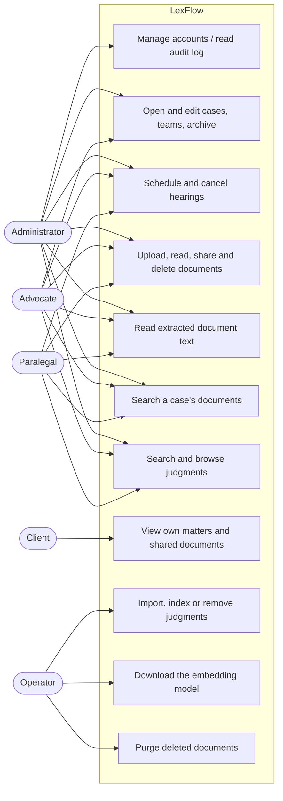
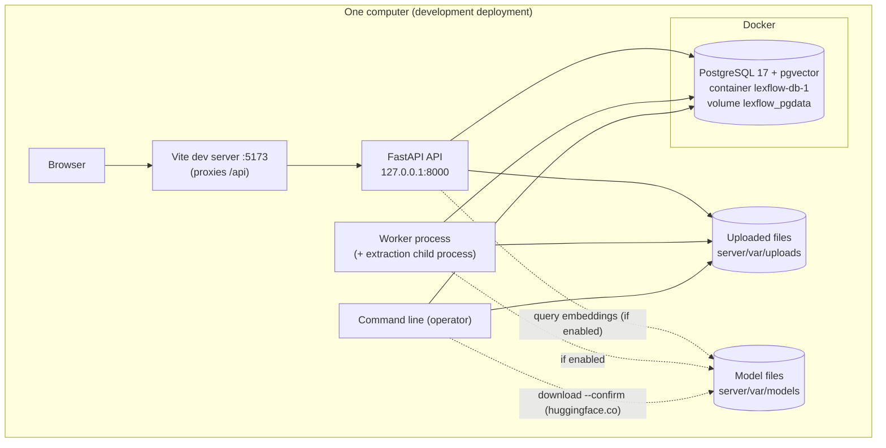
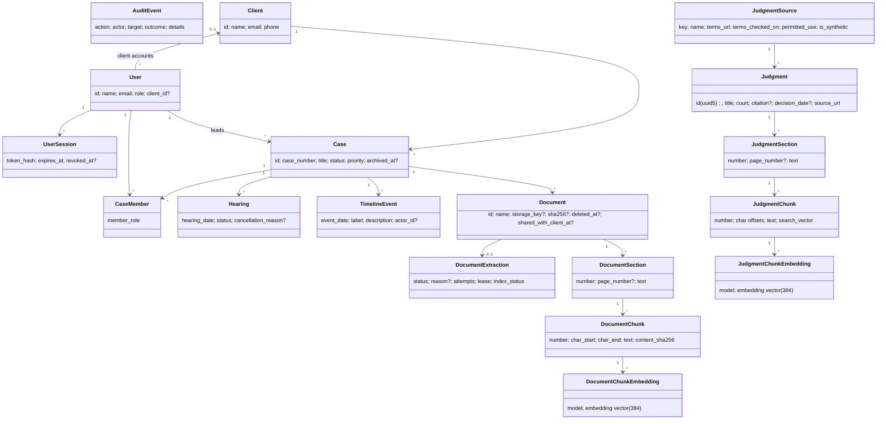

# LexFlow — Architecture and UML

As built through Phase 4 (2026-10-20). Requirements: `docs/SRS.md`. Decisions
and their reasons: `docs/adr/`. Diagrams are Mermaid (they render on GitHub
and in most Markdown viewers).

## 1. Overview

- **Front end:** React 18 + TypeScript (Vite), TanStack Query for server
  state, a typed API client generated from the server's OpenAPI document. Two
  areas: the staff app (`/app`) and the client portal (`/portal`).
- **API:** FastAPI (Python 3.12) on `127.0.0.1:8000`; SQLAlchemy 2 and Alembic;
  RFC 9457 errors; session cookies; access rules in `lexflow/authz.py`.
- **Worker:** `python -m lexflow.worker`, a separate process that extracts
  document text in a child process (time-limited) and, if embeddings are on,
  embeds chunks.
- **Database:** PostgreSQL 17 with pgvector (`pgvector/pgvector:pg17-trixie`),
  also used as the job queue (`FOR UPDATE SKIP LOCKED`, leases).
- **Storage:** uploaded files on local disk behind a `Storage` interface.
- **Local model (optional):** `BAAI/bge-small-en-v1.5` (ONNX, CPU), files
  pinned by SHA-256, downloaded only by an explicit command.
- **Command line (operator):** accounts, purges, document backfill, judgment
  import/index/remove, model download and status.

## 2. Use cases



AI case analysis, review of AI findings and outcome assessment are later
phases and are not shown.

## 3. Deployment



The API binds to `127.0.0.1` only and refuses other host names. No document
text is sent to any external service.

## 4. Data model (main classes)



Case documents and judgments are separate collections: no query joins them,
and tests check that a private case document never appears in judgment search.

## 5. Sequence: upload a document

```mermaid
sequenceDiagram
  actor Lawyer
  participant UI as Staff app
  participant API as FastAPI
  participant DB as PostgreSQL
  participant FS as Local storage
  participant W as Worker
  participant X as Extraction child process
  Lawyer->>UI: choose file
  UI->>API: POST /api/cases/{id}/documents (multipart, CSRF header)
  API->>API: session, role and case checks; size limit while streaming
  API->>FS: store file under a random key (checked type, SHA-256)
  API->>DB: documents row + extraction job "queued" (one transaction) + audit
  API-->>UI: 201 document (processing: queued)
  loop every few seconds while waiting
    UI->>API: GET /api/cases/{id}
  end
  W->>DB: claim job (SKIP LOCKED, lease)
  W->>FS: read file, verify SHA-256
  W->>X: extract text (killed at the time limit)
  X-->>W: sections (pages) or failure
  W->>DB: sections, chunks (+ status ready / failed with reason)
  opt embeddings enabled
    W->>DB: chunk vectors (batches) and index status
  end
  UI->>API: GET /api/cases/{id}
  API-->>UI: processing: ready, N pages
```

## 6. Sequence: search precedents (Research tab)

```mermaid
sequenceDiagram
  actor Lawyer
  participant UI as Research tab / Precedent Library
  participant API as FastAPI
  participant M as Local model (optional)
  participant DB as PostgreSQL
  Lawyer->>UI: type query, choose mode, submit
  UI->>API: GET /api/judgments/search?q&mode&page
  API->>API: staff-only router; validate q (≤ 300), page, filters
  alt keyword
    API->>DB: websearch_to_tsquery over judgment_chunks.search_vector (GIN)
  else semantic or hybrid
    API->>M: embed the query (local, CPU)
    API->>DB: cosine distance over current-model vectors (+ keyword for hybrid)
  end
  DB-->>API: best passage per judgment (≤ 100, deterministic order)
  API->>DB: audit judgment.searched (mode, page, count — not the query)
  API-->>UI: page of results: metadata, passage, page, source URL, synthetic flag
  Lawyer->>UI: open a judgment
  UI->>API: GET /api/judgments/{id} and /text?section=n
```

## 7. Sequence: analyse a case

Required by the brief but **not built**: AI case analysis is Phase 5. The
front end's `AiService` seam (`src/services/ai/aiService.ts`) reports "not
connected" and no analysis is ever simulated. This diagram will be added with
the Phase 5 implementation.

## 8. Cross-cutting rules

- **Access control on the server**; the UI only hides what is not allowed.
- **One contract**: Pydantic models → `server/openapi.json` →
  `src/services/api/schema.gen.ts`; drift fails `npm run api:check`.
- **Nothing destroyed in the app**; purges and judgment removals are guarded
  commands that preview first.
- **Database changes are rehearsed** on a restored copy before reaching the
  development database (see the execution logs).
